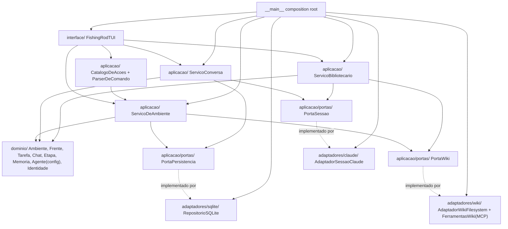

# Application Design — Dependências entre Componentes

**Estágio:** INCEPTION — Application Design · **Profundidade:** comprehensive
**Data:** 2026-08-25 · **Base:** `components.md`, `component-methods.md`, `services.md`

> Este documento fixa **quem pode importar quem**, os padrões de comunicação entre camadas, o
> fluxo de dados de ponta a ponta, e a prova de que o núcleo não depende de `claude_agent_sdk` nem
> de `sqlite3` (RF-F04, D-ARQ-04). É o artefato que Code Generation usa para verificar violação de
> camada por inspeção de import.

---

## 1. Regra de import por camada (Pergunta 2A)

```
interface/    pode importar   aplicacao/
aplicacao/    pode importar   dominio/, aplicacao/portas/
dominio/      não importa     aplicacao/, adaptadores/, interface/, claude_agent_sdk, sqlite3, textual
adaptadores/  pode importar   dominio/ (tipos de retorno), aplicacao/portas/ (para implementar)
adaptadores/  NÃO importa     interface/
composition_root (__main__)  importa TUDO — é o único ponto de violação intencional (Pergunta 11A)
```

**Regra geral, verificável por `grep`/inspeção estática**:

| De → Para | Permitido? |
|---|---|
| `dominio/` → qualquer outra camada | **Não** |
| `dominio/` → `claude_agent_sdk`, `sqlite3`, `textual` | **Não** (RF-F04, e por extensão nunca acoplado a infraestrutura) |
| `aplicacao/` → `dominio/` | Sim |
| `aplicacao/` → `aplicacao/portas/` (interfaces) | Sim |
| `aplicacao/` → `adaptadores/` (implementação concreta) | **Não** — aplicação só conhece a porta, não o adaptador |
| `aplicacao/` → `claude_agent_sdk`, `sqlite3` | **Não** |
| `adaptadores/sqlite/` → `sqlite3` | Sim (é o único lugar) |
| `adaptadores/claude/` → `claude_agent_sdk` | Sim (é o único lugar) |
| `adaptadores/wiki/` → filesystem (`pathlib`, `tomllib`) | Sim |
| `interface/` → `aplicacao/` | Sim |
| `interface/` → `dominio/` | Evitar; se acontecer, só para tipos de leitura (ex.: exibir nome), nunca para invocar invariante |
| `interface/` → `adaptadores/`, `claude_agent_sdk`, `sqlite3` | **Não** |
| `__main__` (composition root) → todas as camadas e adaptadores | Sim — é o ponto único autorizado |

### Prova executável de RF-F04

Critério de aceite de TD-02 (Pergunta 17A): existe um teste que importa o pacote `dominio/` (e
`aplicacao/`) com `claude_agent_sdk` **desinstalado** do ambiente de teste, e o import não falha.
Isso prova a fronteira de forma executável — o único jeito de o teste voltar a falhar é alguém
reintroduzir o import fora de `adaptadores/claude/`.

Mesma lógica se aplica a `sqlite3`: um teste equivalente garante que `dominio/` e `aplicacao/`
(exceto `adaptadores/sqlite/`) não importam `sqlite3` — `sqlite3` é stdlib, então o teste aqui é
uma verificação estática de import (ex.: varredura de AST ou `grep` em CI), não ausência de
pacote.

---

## 2. Matriz de dependência — componente × componente

`X` = depende de. Linhas = quem depende; colunas = de quem.

| | `Identidade` | `Ambiente`/`Frente`/`Tarefa`/`Chat`/`Etapa`/`Memoria` | `Agente` (config) | `CatalogoDeAcoes` | `ParserDeComando` | `ServicoDeAmbiente` | `ServicoConversa` | `ServicoBibliotecario` | `PortaPersistencia` | `PortaSessao` | `PortaWiki` | `RepositorioSQLite` | `AdaptadorSessaoClaude` | `AdaptadorWikiFilesystem`/`FerramentasWiki` | `FishingRodTUI` |
|---|---|---|---|---|---|---|---|---|---|---|---|---|---|---|---|
| `Ambiente`/... | X | — | — | | | | | | | | | | | | |
| `Agente` (config) | X | | — | | | | | | | | | | | | |
| `CatalogoDeAcoes` | | | | — | | X | | | | | | | | | |
| `ParserDeComando` | | X (resolve alvo) | | | — | | | | | | | | | | |
| `ServicoDeAmbiente` | X | X | X | | | — | | | X | | X | | | | |
| `ServicoConversa` | X | X | X | | | | — | | X | X | | | | | |
| `ServicoBibliotecario` | X | | X | | | | | — | | X | X | | | | |
| `RepositorioSQLite` | X (desserializa) | X (desserializa) | X | | | | | | (implementa) | | | — | | | |
| `AdaptadorSessaoClaude` | | | X (lê config) | | | | | | | (implementa) | | | — | | |
| `AdaptadorWikiFilesystem`/`FerramentasWiki` | | | | | | | | | | | (implementa) | | | — | |
| `FishingRodTUI` | | | | X | X | X | X | X | | | | | | | — |
| `__main__` | | | | X | X | X | X | X | X (injeta) | X (injeta) | X (injeta) | X (constrói) | X (constrói) | X (constrói) | X (constrói) |

Leitura: por exemplo, `ServicoConversa` depende de `Identidade`, das entidades de domínio
(`Chat`, `Tarefa`), de `Agente` (config), de `PortaPersistencia` e de `PortaSessao` — nunca de
`RepositorioSQLite` ou `AdaptadorSessaoClaude` diretamente.

---

## 3. Padrões de comunicação

### 3.1 Interface → Aplicação: chamada direta assíncrona

A TUI chama métodos `async` dos serviços e do catálogo diretamente (não há barramento de eventos
nem fila entre interface e aplicação nesta iteração — seria overengineering para um processo local
single-user). Streaming de conversa é consumido via `async for` sobre o iterador devolvido por
`ServicoConversa.enviar`/`ServicoBibliotecario.enviar`.

### 3.2 Aplicação → Domínio: chamada direta síncrona

Serviços chamam métodos de domínio diretamente (ex.: `frente.criar_tarefa(nome)`) — domínio não é
assíncrono, porque não faz I/O; só aplicação (que fala com portas) precisa ser assíncrona.

### 3.3 Aplicação → Portas: interface assíncrona (Protocol)

Toda comunicação de aplicação com infraestrutura passa por uma porta (`PortaPersistencia`,
`PortaSessao`, `PortaWiki`), nunca por import direto de adaptador. Em Python, isso é modelado como
`Protocol` (ou ABC) — não é necessário framework de DI (Pergunta 11, reforço).

### 3.4 Porta → Adaptador: injeção no composition root

O adaptador concreto é escolhido uma única vez, no `__main__`, e passado por parâmetro aos
serviços. Nenhum serviço ou porta descobre o adaptador em runtime por lookup (Pergunta 11,
rejeição explícita da opção C — container/registry).

### 3.5 Bibliotecário → Ferramentas de wiki: MCP in-process

O único ponto de comunicação "agente → tool" desta iteração é a sessão do bibliotecário com as
`FerramentasWiki`, expostas como servidor MCP in-process (medido pelo spike:
`create_sdk_mcp_server`, despacho de função no mesmo processo, sem serialização real).
`AdaptadorSessaoClaude` é responsável por montar essa configuração (`mcp_servers`, `allowed_tools`,
`tools=[]` para negar nativas) quando abre a sessão do bibliotecário — não quando abre a do
orquestrador nesta iteração (o orquestrador não tem ferramentas de wiki concedidas diretamente,
ver §5 do plano, reconciliação da Pergunta 3-bis).

---

## 4. Fluxo de dados — visão de ponta a ponta

### 4.1 Fluxo de comando estrutural (`/nova-tarefa`)

```
Usuário digita "/nova-tarefa campanha de verao"
    → FishingRodTUI captura entrada
    → ParserDeComando.detectar() = True
    → ParserDeComando.interpretar() → ("nova-tarefa", {"nome": "campanha de verao"}, alvo=frente_ativa)
    → CatalogoDeAcoes.executar("nova-tarefa", alvo, args)
    → Acao.executar(alvo, args) chama ServicoDeAmbiente.criar_tarefa(id_frente, nome)
    → ServicoDeAmbiente carrega Frente via PortaPersistencia, chama Frente.criar_tarefa (domínio)
    → ServicoDeAmbiente persiste via PortaPersistencia.salvar_ambiente
    → Resultado(sucesso=True, dado=id_tarefa_nova) volta pela mesma cadeia
    → FishingRodTUI renderiza confirmação
```

### 4.2 Fluxo de conversa (streaming)

```
Usuário digita texto sem "/"
    → FishingRodTUI → ServicoConversa.enviar(id_chat, texto)
    → ServicoConversa resolve/abre SessaoViva via PortaSessao.abrir
    → ServicoConversa grava mensagem do usuário (PortaPersistencia.inserir_mensagem)
    → ServicoConversa grava linha "em andamento" do agente
    → PortaSessao.enviar → AdaptadorSessaoClaude → ClaudeSDKClient.query/receive_response
    → eventos convertidos (AssistantMessage/TextBlock/... → EventoConversa) sobem por PortaSessao
    → ServicoConversa, a cada evento:
         pedaço de texto  → atualiza mensagem no banco + repassa para TUI (render incremental)
         uso de ferramenta → registra resumo no banco
         fim de turno      → remove marca "em andamento"
    → FishingRodTUI mostra a resposta completa ao final do iterador
```

### 4.3 Fluxo de escrita na wiki (proposta → aprovação)

```
Usuário conversa com bibliotecário: "promove isso à wiki"
    → ServicoBibliotecario.enviar(mensagem) → PortaSessao (sessão própria do bibliotecário)
    → agente decide, via prompt (Pergunta 13), entre propor_entidade / propor_propriedade
    → chamada de tool despachada via MCP in-process → FerramentasWiki.propor_propriedade(...)
    → tool NÃO escreve; devolve estrutura de proposta
    → ServicoBibliotecario guarda PropostaWiki em memória/pendências
    → FishingRodTUI lista propostas_pendentes(), usuário revisa texto final (US-14)
    → usuário aprova → ServicoBibliotecario.aprovar(id_proposta)
        → validação de links (PortaWiki.listar/ler)
        → PortaWiki.escrever_proposta → AdaptadorWikiFilesystem confina caminho e grava
        → PortaWiki.renderizar_index → index.md regenerado
    → Resultado(sucesso=True) volta à TUI
```

### 4.4 Fluxo de abertura do programa

```
uv run fishingrod
    → __main__ lê config (raiz de dados, raiz de wikis)
    → __main__ constrói RepositorioSQLite, AdaptadorSessaoClaude, AdaptadorWikiFilesystem,
      FerramentasWiki/MCP, e os serviços de aplicação
    → __main__ instancia FishingRodTUI(servicos) e chama .run()
    → FishingRodTUI, no evento de montagem, chama ServicoDeAmbiente.carregar_ambiente(id)
        → RepositorioSQLite.carregar_ambiente (possivelmente via asyncio.to_thread)
    → TUI renderiza a estrutura carregada; transcrição de cada chat só é buscada quando a aba abre
```

---

## 5. Diagrama consolidado de dependências (Mermaid)



**Alternativa textual do diagrama** (fallback, caso o Mermaid não renderize): A TUI depende do
catálogo de ações, e dos três serviços de aplicação (ambiente, conversa, bibliotecário). O catálogo
de ações depende do serviço de ambiente. Os três serviços dependem do domínio. O serviço de
ambiente depende das portas de persistência e de wiki. O serviço de conversa depende das portas de
persistência e de sessão. O serviço de bibliotecário depende das portas de sessão e de wiki. Cada
porta é implementada por exatamente um adaptador nesta iteração (SQLite, Claude SDK, filesystem).
O composition root (`__main__`) é o único módulo que conhece e constrói os três adaptadores, os
três serviços e a TUI, injetando tudo montado.

---

## 6. Verificação de ausência de ciclo

Não há dependência circular: `interface → aplicacao → dominio` e `aplicacao(portas) ← adaptadores`
formam um grafo acíclico. `adaptadores` nunca importa `interface`; `dominio` nunca importa nada
fora de si mesmo (além de stdlib básica para dataclasses/typing). O único nó com fan-out alto é
`__main__`, que é esperado para um composition root.

---

## 7. Checklist de conformidade (para Code Generation verificar)

- [ ] Nenhum arquivo em `dominio/` contém `import claude_agent_sdk`.
- [ ] Nenhum arquivo em `dominio/` contém `import sqlite3`.
- [ ] Nenhum arquivo em `dominio/` contém `import textual` (nem `from textual`).
- [ ] Nenhum arquivo em `aplicacao/` (fora de `aplicacao/portas/`, que são só interfaces) importa
      `claude_agent_sdk` ou `sqlite3`.
- [ ] `adaptadores/claude/` é o único diretório que importa `claude_agent_sdk`.
- [ ] `adaptadores/sqlite/` é o único diretório que importa `sqlite3`.
- [ ] Nenhum arquivo em `interface/` importa de `adaptadores/`.
- [ ] `__main__.py` (ou `composicao.py`) é o único arquivo que importa de todas as camadas.
