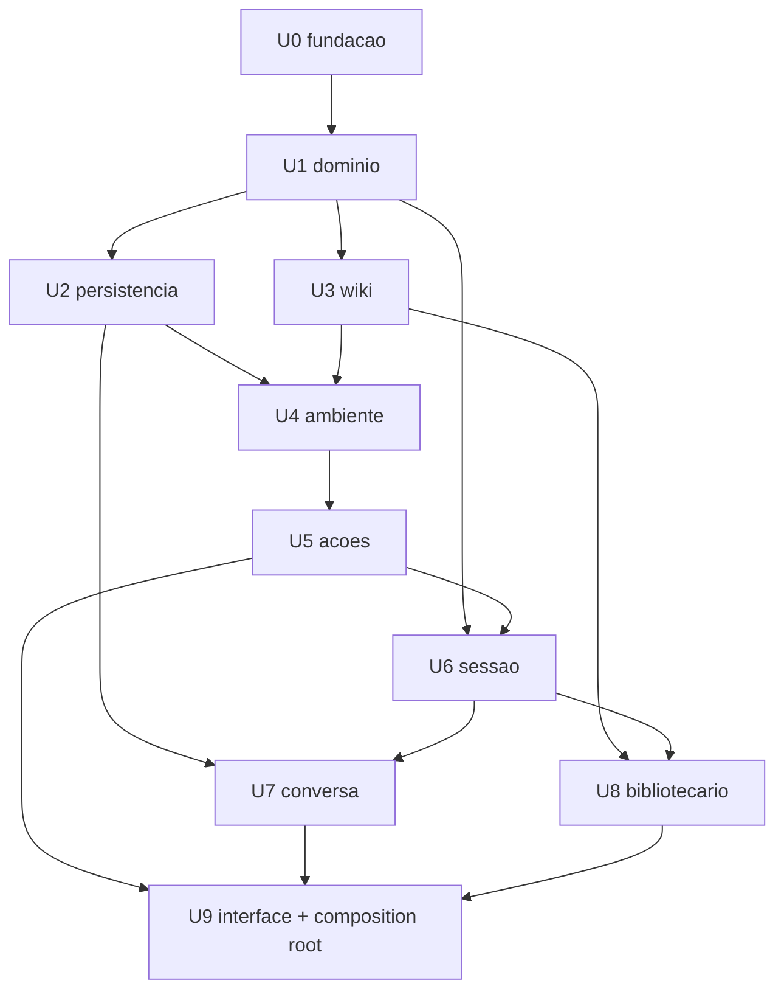

# Units of Work — Matriz de dependência e ordem de execução

**Estágio:** INCEPTION — Units Generation, Parte 2 · **Data:** 2026-08-25
**Base:** `unit-of-work.md` (10 unidades), `component-dependency.md` §1 (regra de import por camada)

---

## 1. O que "depende" significa aqui

Unidade **A depende de** B quando o código de A importa um símbolo definido por B, ou quando o
critério de pronto de A não pode ser verificado sem B existir. Não é dependência de cronograma — é
dependência de compilação e de teste.

**Exceção única**: `ComposicaoRoot` (dentro de `U9`) importa todas as camadas por definição. É o
lado de fora, onde a regra "não atravesse camadas" não se aplica (`components.md` §3.6). Por isso
`U9` depende de tudo e nada depende de `U9`.

---

## 2. Matriz

Linha = unidade. Coluna = de quem ela depende. `✔` = depende.

| ↓ depende de → | U0 | U1 | U2 | U3 | U4 | U5 | U6 | U7 | U8 | U9 |
|---|:--:|:--:|:--:|:--:|:--:|:--:|:--:|:--:|:--:|:--:|
| **U0** `fundacao` | — | | | | | | | | | |
| **U1** `dominio` | ✔ | — | | | | | | | | |
| **U2** `persistencia` | ✔ | ✔ | — | | | | | | | |
| **U3** `wiki` | ✔ | ✔ | | — | | | | | | |
| **U4** `ambiente` | ✔ | ✔ | ✔ | ✔ | — | | | | | |
| **U5** `acoes` | ✔ | ✔ | | | ✔ | — | | | | |
| **U6** `sessao` | ✔ | ✔ | | | | **✔** | — | | | |
| **U7** `conversa` | ✔ | ✔ | ✔ | | | | ✔ | — | | |
| **U8** `bibliotecario` | ✔ | ✔ | | ✔ | | | ✔ | | — | |
| **U9** `interface` | ✔ | ✔ | ✔ | ✔ | ✔ | ✔ | ✔ | ✔ | ✔ | — |

**Triangular inferior, sem exceção** — nenhuma marca acima da diagonal. Isso é a prova visual de que
o grafo é acíclico: se houvesse ciclo, alguma unidade dependeria de outra de número maior.

> **/!\ Emenda 2026-10-02 - Functional Design de U6 `sessao` (Q9=A).** A marca **U6 → U5** em
> negrito é nova. A conversão de ação do catálogo em ferramenta (esquema a partir do `Parametro`,
> texto a partir do `Resultado`) mora num módulo de aplicação de U6 sem SDK
> (`aplicacao/ferramentas/`), que importa `CatalogoDeAcoes`. A matriz continua triangular inferior
> (U5 vem antes de U6) e a ordem de execução não muda. A seta ausente **U7 → U5** da §3.1 continua
> ausente: quem importa o módulo de ferramentas é só o composition root (U9).

---

## 3. Justificativa de cada dependência não óbvia

| Dependência | Por quê |
|---|---|
| **U4 → U3** | `ServicoDeAmbiente.criar_ambiente` materializa a wiki a partir do `EsquemaWiki` e chama `renderizar_index` (`services.md` §2, passos 7 e 8). **Esta é a seta que corrigiu a ordem candidata do plano** — ver `unit-of-work.md` §2 |
| **U5 → U4** | As ações do catálogo são cascas finas sobre `ServicoDeAmbiente`; criar frente/tarefa/chat passa por ele |
| **U7 → U2** | A política de gravação (mensagem inserida no início do turno, atualizada no streaming) é feita pelo serviço de conversa contra a porta de persistência |
| **U6 → U5** | **[emenda FD de U6, Q9=A]** As 6 ações viram ferramentas de ambiente num módulo de aplicação de U6, sem SDK, que lê o registro do catálogo e executa por `CatalogoDeAcoes.executar` |
| **U8 → U6** | O bibliotecário abre sessão viva própria, isolada da do orquestrador |
| **U8 → U3** | `FerramentasWiki` opera sobre `PortaWiki`; a escrita aprovada e a revalidação do índice são do adaptador de wiki |

## 3.1 Duas setas que **não** existem, e que precisavam ser verificadas

| Seta ausente | Por quê ela não existe |
|---|---|
| **U7 → U5** (`ServicoConversa` → `CatalogoDeAcoes`) | Este era o risco escondido da reconciliação **R4**. Se `ServicoConversa` tivesse que montar a lista de ferramentas do orquestrador, importaria o catálogo, acoplando duas unidades que Q2=A quer independentes. Não acontece porque `Agente` carrega **nomes** de ferramentas; o registro nome→função é montado pelo composition root (`U9`); `AdaptadorSessaoClaude` (`U6`) resolve os nomes. Só o `__main__` conhece os dois lados |
| **U5 → U8** e **U8 → U5** | As duas unidades consultam a mesma política de aprovação, mas nenhuma importa a outra: ~~ambas leem um campo do `Ambiente` (`U1`)~~ **[rodada 4, 2026-08-25]** ambas chamam `exige_aprovacao(...)` de `dominio/politica.py` (`U1`), módulo que já está abaixo das duas na ordem. A revogação do parâmetro configurável **não muda a matriz**: a seta continua ausente pelo mesmo motivo, e o destino da dependência continua sendo `U1`. O fluxo de confirmação em si é de `U9` |

---

## 4. Diagrama



**Alternativa textual** (obrigatória por `common/content-validation.md`; a seta lê-se "é
pré-requisito de"):

- `U0` → `U1`
- `U1` → `U2`, `U3`, `U6`
- `U2` → `U4`, `U7`
- `U3` → `U4`, `U8`
- `U4` → `U5`
- `U5` → `U6` **[emenda FD de U6, Q9=A]**
- `U6` → `U7`, `U8`
- `U5`, `U7`, `U8` → `U9`

O diagrama omite as setas transitivas (por exemplo `U0 → U9`) para não virar um emaranhado; a matriz
da §2 é a fonte completa.

---

## 5. Ordem de execução

**Q7=A: estritamente sequencial.** Nenhuma unidade em paralelo, mesmo onde o grafo permitiria
(`U3` e `U2` são independentes entre si, por exemplo). A ordem abaixo é a numeração das unidades, que
foi escolhida justamente para ser uma ordem topológica válida:

```
U0 → U1 → U2 → U3 → U4 → U5 → U6 → U7 → U8 → U9
```

**Verificação**: cada unidade só aparece depois de todas as de que depende — conferível pela matriz
da §2 ser triangular inferior.

### O que fica demonstrável, e quando

| Depois de | Você consegue ver |
|---|---|
| U0–U8 | Nada na tela. Só teste automatizado passando (Q4=A, consequência de Q2=A) |
| **U9** | Tudo de uma vez: as 14 histórias na TUI |

Isso é o custo declarado da decomposição horizontal, repetido aqui porque é onde ele dói: o risco de
integração está concentrado em `U9`. A mitigação prevista é a rigidez do contrato de porta — cada
unidade fecha contra uma interface testada, não contra a próxima unidade.
