# Plano de Execução — FishingRod, Iteração 1

**Versão:** v2 · **Data:** 2026-08-19 · **Estágio:** INCEPTION — Workflow Planning
**Base:** `requirements.md` v2 (incluindo a Emenda §9), `stories.md` (escopo da linha fina v2),
`personas.md`, artefatos de Reverse Engineering

> **v2** reescreve o plano após a sessão de revisão de 2026-08-19, em que o usuário reabriu cinco
> pontos e fechou oito decisões. Nenhuma decisão EXECUTE/SKIP de estágio mudou; mudaram escopo,
> substrato, interface, sequência, riscos e gates. Rastreio completo em `requirements.md` §9 e em
> `audit.md`.

---

## Decisões fechadas na revisão v2

| # | Decisão | Rastreio |
|---|---|---|
| **1** | Persistência em **SQLite** (`sqlite3`, stdlib) atrás de porta modelada pelo domínio; híbrida — estrutura do ambiente como documento, transcrição normalizada | ESC-13, D-ARQ-04 |
| **2** | **Identidade opaca e estável** (UUID/ULID) substitui endereçamento posicional e nominal | ESC-14, RF-F16, D-ARQ-05 |
| **3** | **Uma porta de sessão, um adaptador** (`claude-agent-sdk`, assinatura). Sem desenho de API key. **RF-F04 permanece**: núcleo sem `claude_agent_sdk` | ESC-18, FOR-09, D-ARQ-06 |
| **4** | Scaffolding com **uv** + layout `src/` + pacote real + `uv.lock` + `exclude-newer` | ESC-15 |
| **5** | **TUI (Textual)** é a única interface entregável; `cli.py` é experimentação do dono, sem garantias; web fica para iteração futura | ESC-16, FOR-10, FOR-11, D-ARQ-07 |
| **6** | **Wiki no filesystem**, markdown, arquivo é a fonte da verdade; entidade=pasta / propriedade=arquivo, dois níveis; `index.md`; links `[[...]]`; acesso só por tools do bibliotecário; esquema plugável como semente | ESC-17, ESC-19, ESC-20, RF-F13/14/15, D-ARQ-08 |
| **7** | Roda **na máquina de cada usuário**, cada um com a própria assinatura | D-ARQ-09 |
| **8** | **Linha fina de 14 histórias**; US-07, US-10, US-11, US-12, US-18 adiadas | §9.6, FOR-14 |

---

## O fluxo da linha fina

Critério de linha fina, definido pelo usuário: *o software já entrega uso e já pode ser posto na
mão do usuário de validação*. Hipótese escolhida para validar: **o loop ambiente → conversa →
wiki torna o ambiente mais inteligente com o tempo**.

A tabela abaixo é o caminho ponta a ponta desta iteração. Cada linha mostra o que o usuário faz,
o que precisa existir embaixo para aquilo funcionar, e quais histórias fecham naquele ponto.

| # | O que o usuário faz | O que tem que existir embaixo | Histórias |
|---|---|---|---|
| **0** | `uv run fishingrod` e a TUI abre | Scaffolding uv, layout `src/`, pacote real, lockfile. Passo mecânico, sem decisão de arquitetura | — |
| **1** | Cria o ambiente "Nexo Aquisição"; ele já nasce com a wiki materializada a partir de um esquema | Domínio com **identidade estável**; porta de persistência + SQLite gravando a estrutura; raiz de wiki no disco; esquema-semente criando entidades, propriedades e `index.md` | US-08, US-09 |
| **2** | Cria a frente "mídia paga" | Domínio + persistência | US-15 |
| **3** | Cria a tarefa "campanha para donos de clínica", com memória própria | Domínio + persistência; memória por tarefa | US-16 |
| **4** | Abre a aba do orquestrador e **conversa de verdade** com o Claude | Porta de sessão (`abrir`/`enviar`/`fechar`) + adaptador `claude-agent-sdk`; ciclo async integrado ao event loop do Textual; transcrição gravada a cada turno | US-01, US-02 |
| **5** | O provedor cai, ou falta credencial: a tela mostra o erro e o resto do ambiente continua vivo | Falha isolada na fronteira do adaptador; mensagem sem vazar detalhe interno | US-03 |
| **6** | Um fato que surgiu na conversa vira anotação na memória da tarefa | `Memoria.anotar()` corrigido (hoje levanta `KeyError` na primeira escrita de chave nova) | US-04 |
| **7** | As etapas da tarefa saem da conversa com o orquestrador | Etapas como dado do domínio + persistência | US-17 |
| **8** | Aciona um agente para executar uma etapa; ou marca "eu fiz" quando o executor é ele | Execução via chat; marcação de etapa concluída | US-19 |
| **9** | Pede ao bibliotecário para promover conteúdo à wiki; **revisa antes** de a escrita acontecer | Agente bibliotecário com tools de wiki; caminho **resolvido e confinado** na raiz; links validados na escrita; revisão humana obrigatória antes de gravar | US-13, US-14 |
| **10** | Fecha a TUI, mata o processo, abre de novo — **e tudo está lá** | Estrutura e transcrição no SQLite; wiki no filesystem; carregamento na abertura | US-05, US-06 |

O passo **10** é o que fecha a linha: sem ele os nove anteriores não entregam uso, entregam
demonstração. O passo **9** é o que valida a hipótese: é ele que faz a wiki ser alimentada *pelo
trabalho*, e não à mão.

**Fora da linha fina, e por quê**: US-07 (retomada nativa da memória do agente — *best-effort*, e
US-06 já entrega a continuidade percebida), US-10 (esquema mutando em runtime), US-11 e US-12
(rod-maker — cai com a escolha da hipótese), US-18 (reaproveitar tarefa — só tem valor depois de
existir histórico), US-20 a US-23 (multiusuário, fora desde a v1).

---

## Resumo da análise detalhada

### Escopo da transformação

- **Tipo**: transformação arquitetural brownfield, local, processo único, sem rede exposta.
- **Objetivo**: entregar uma fatia vertical utilizável por um usuário, conectada a um LLM real,
  persistente, com wiki alimentada pelo trabalho, e extensível sem acoplar o núcleo ao provedor.
- **Mudanças principais**:
  - scaffolding de projeto com `uv`, layout `src/`, pacote real e dependências travadas;
  - identidade opaca e estável no domínio, substituindo endereçamento por índice;
  - porta de sessão com **um** adaptador (`claude-agent-sdk`, assinatura), sem tipo do SDK no núcleo;
  - persistência SQLite atrás de porta de domínio, híbrida;
  - wiki no filesystem em markdown, com abstração entidade/propriedade, `index.md`, links e
    esquema-semente plugável;
  - bibliotecário com tools de wiki, escrita confinada e revisão humana antes de gravar;
  - fluxo solo de frentes, tarefas, etapas e execução por chat;
  - TUI evoluída como única interface, sem regra de negócio na tela;
  - suíte de testes de exemplo e baseados em propriedade.
- **Histórias implementáveis**: 14 (ver o fluxo da linha fina acima).
- **Fora desta iteração**: US-07, US-10, US-11, US-12, US-18, US-20 a US-23, autenticação por API
  key (nem desenhada), interface web, `ingest`/`raw/` e `lint` da wiki, wiki compartilhada e
  sincronização, multiusuário, governança, nuvem, deploy, MCP externo configurável, dashboard
  numérico e renomeação do vocabulário do código.

### Avaliação de impacto

| Área | Impacto | Descrição |
|---|---|---|
| Experiência do usuário | Sim | Conversa real, retomada após reinício, wiki alimentada pelo trabalho, agente bibliotecário e fluxo solo passam a funcionar de ponta a ponta na TUI. |
| Estrutura | Sim, alto | Novas fronteiras entre domínio, portas, adaptadores, persistência e wiki; revisão da cadeia `Ambiente → Projeto → Sessao`; endereçamento posicional substituído por identidade. |
| Modelo de dados | Sim, alto | Estado hoje só em memória passa a ter identidade estável, representação persistível, versionamento e regras de integridade. |
| Interfaces e contratos | Sim, alto | O contrato síncrono `Agente.responder()` cede lugar a um ciclo de sessão assíncrono; a TUI passa a carregar e salvar. |
| Substrato de armazenamento | Sim, novo | Dois substratos deliberados: SQLite (estrutura e transcrição) e filesystem (wiki). RNF-12 impede que o segundo seja duplicado no primeiro. |
| NFRs | Sim, alto | Dependências reproduzíveis, credenciais por usuário, integridade, confinamento de caminho, fail-safe e estratégia de testes com Hypothesis. |
| Infraestrutura | Não | Processo local, sem servidor, sem porta de rede, sem container, sem nuvem, sem deploy. Reforçado pela v2: a interface web saiu do escopo. |

### Relações entre componentes

- **Componente primário**: núcleo em `Ambiente/`, especialmente `agente.py`, `sessao.py`,
  `ambiente.py` e `memoria.py`.
- **Modelos compartilhados**: `model/mensagem.py` e `model/comando.py`. O `Comando` sobrevive à
  troca de interface: o mockup do usuário mantém paleta acionada por `/`, então o vocabulário de
  comando continua válido na TUI.
- **Adaptador externo**: `claude-agent-sdk`, hoje importado pelo núcleo (`agente.py:6`) e
  validado apenas pelo spike descartável em `testes-de-aprendizado/spike_claudeSDK.py`.
- **Interface**: `tui.py` — já implementa o esqueleto do layout do mockup (sidebar de projetos,
  árvore de sessões/chats, log de conversa, barra de status com caminho completo) e já declara a
  disciplina certa ("aqui só existe pintura"). É evolução, não reescrita.
- **Componentes novos esperados, sujeitos a Application Design**: porta de sessão viva, adaptador
  Claude, porta e implementação de persistência, wiki no filesystem com esquema-semente,
  ferramentas do bibliotecário.
- **Testes**: suíte nova cobrindo domínio, serialização, persistência, confinamento de caminho,
  adaptador e integração núcleo/TUI.

| Componente | Tipo de mudança | Motivo | Prioridade |
|---|---|---|---|
| Fundação do projeto (`uv`, `src/`, lockfile) | Novo | Reprodutibilidade, supply chain, e corrigir namespace packages que só resolvem da raiz | Crítica |
| Identidade do domínio | Maior | Persistência exige chave estável; nome muda e índice se move | Crítica |
| Contratos e modelos compartilhados | Maior | Fronteiras estáveis e representações independentes de provedor | Crítica |
| `Ambiente/agente.py` | Maior | Remover tipo do SDK, substituir stubs, modelar capacidades e o ciclo assíncrono | Crítica |
| `Ambiente/sessao.py` | Maior | Ciclo de vida do chat, isolamento entre chats, falhas | Crítica |
| `Ambiente/ambiente.py` | Maior | Criação de ambiente com wiki semeada, persistência, fluxo de frentes/tarefas | Crítica |
| `Ambiente/memoria.py` | Menor estrutural | Corrigir primeira escrita e tornar persistível | Crítica |
| Persistência (porta + SQLite) | Novo | Retomada diária, integridade, atomicidade | Crítica |
| Wiki no filesystem + esquema-semente | Novo | RF-F07/08/13/15; é o substrato do loop que a iteração valida | Crítica |
| Adaptador Claude | Novo/maior | Assinatura funcionando sem contaminar o núcleo | Crítica |
| Bibliotecário e tools de wiki | Novo | US-13/US-14; ponto único de estrangulamento de segurança da wiki | Crítica |
| `tui.py` | Moderada | Compor dependências, ciclo carregar/salvar/fechar, painel de memória, streaming | Importante |
| `cli.py` | Sem garantia | Experimentação do dono; não é entregável e não tem veto sobre o núcleo | Nenhuma |
| Suíte de testes | Novo | Regressão, PBT, e provar RF-F04 (núcleo roda sem o SDK) | Crítica |
| `interface_ilustrativa.html`, `informacoes-usuario/` | Sem mudança | Maquetes e insumo; referência de layout apenas | Nenhuma |

### Avaliação de risco

- **Nível de risco**: alto.
- **Justificativa**: a mudança atravessa todo o núcleo, introduz identidade, dois substratos de
  armazenamento, um limite assíncrono/externo e um agente que escreve no disco — partindo de uma
  base sem testes, sem lockfile e sem build declarado, com decisões arquiteturais ainda
  deliberadamente abertas.
- **Complexidade de rollback**: moderada para código via Git; difícil para dados se um formato
  persistido incompatível for publicado sem versionamento ou migração.
- **Complexidade de teste**: alta — estado mutável, round-trips de serialização, falhas de I/O,
  escrita em disco com confinamento, e integração opcional com um CLI autenticado.
- **Riscos principais**:
  1. vazar tipo ou ciclo de vida do SDK para o domínio, quebrando testabilidade sem credencial;
  2. identidade mal desenhada — se nascer torta, a interface web de amanhã é reescrita, não adaptador novo;
  3. persistir grafo incompleto ou corromper dados em escrita interrompida;
  4. divergência entre os dois substratos (mitigado por construção via RNF-12);
  5. **escrita de wiki fora da raiz** por caminho vindo do LLM (travessia de diretório), e conteúdo de wiki influenciando o agente (prompt injection);
  6. **apodrecimento da wiki** por falta de critério do bibliotecário entre criar entidade e criar propriedade — risco número um do desenho da wiki, registrado como nota retida;
  7. misturar histórico ou sessão nativa entre chats/agentes;
  8. criar um modelo específico para marketing e falhar no domínio de estudos;
  9. corrigir dívidas antes de fechar a arquitetura e refazer trabalho;
  10. o subprocesso do CLI do provedor disputar o terminal com a TUI — **risco medido e afastado pelo spike**: `stderr` chega por callback e permissão é programática, sem prompt interativo.

---

## Visualização do workflow

```mermaid
flowchart TD
    Start(["Retomada da iteracao"])

    subgraph INCEPTION["INCEPTION"]
        WD["Workspace Detection<br/><b>COMPLETED</b>"]
        RE["Reverse Engineering<br/><b>COMPLETED</b>"]
        RA["Requirements Analysis<br/><b>COMPLETED + EMENDADO v2</b>"]
        US["User Stories<br/><b>COMPLETED + ESCOPO v2</b>"]
        WP["Workflow Planning<br/><b>COMPLETED v2</b>"]
        AD["Application Design<br/><b>EXECUTE</b>"]
        UG["Units Generation<br/><b>EXECUTE</b>"]
    end

    subgraph CONSTRUCTION["CONSTRUCTION"]
        FD["Functional Design<br/><b>EXECUTE</b>"]
        NFRA["NFR Requirements<br/><b>EXECUTE</b>"]
        NFRD["NFR Design<br/><b>EXECUTE</b>"]
        ID["Infrastructure Design<br/><b>SKIP</b>"]
        CG["Code Generation<br/><b>EXECUTE</b>"]
        BT["Build and Test<br/><b>EXECUTE</b>"]
    end

    subgraph OPERATIONS["OPERATIONS"]
        OPS["Operations<br/><b>PLACEHOLDER</b>"]
    end

    Start --> WD
    WD --> RE
    RE --> RA
    RA --> US
    US --> WP
    WP --> AD
    AD --> UG
    UG --> FD
    FD --> NFRA
    NFRA --> NFRD
    NFRD --> CG
    NFRD -.-> ID
    ID -.-> CG
    CG -.->|"proxima unidade"| FD
    CG --> BT
    BT -.-> OPS
    BT --> End(["Iteracao concluida"])

    style WD fill:#4CAF50,stroke:#1B5E20,stroke-width:3px,color:#fff
    style RE fill:#4CAF50,stroke:#1B5E20,stroke-width:3px,color:#fff
    style RA fill:#4CAF50,stroke:#1B5E20,stroke-width:3px,color:#fff
    style US fill:#4CAF50,stroke:#1B5E20,stroke-width:3px,color:#fff
    style WP fill:#4CAF50,stroke:#1B5E20,stroke-width:3px,color:#fff
    style AD fill:#FFA726,stroke:#E65100,stroke-width:3px,stroke-dasharray:5 5,color:#000
    style UG fill:#FFA726,stroke:#E65100,stroke-width:3px,stroke-dasharray:5 5,color:#000
    style FD fill:#FFA726,stroke:#E65100,stroke-width:3px,stroke-dasharray:5 5,color:#000
    style NFRA fill:#FFA726,stroke:#E65100,stroke-width:3px,stroke-dasharray:5 5,color:#000
    style NFRD fill:#FFA726,stroke:#E65100,stroke-width:3px,stroke-dasharray:5 5,color:#000
    style ID fill:#BDBDBD,stroke:#424242,stroke-width:2px,stroke-dasharray:5 5,color:#000
    style CG fill:#4CAF50,stroke:#1B5E20,stroke-width:3px,color:#fff
    style BT fill:#4CAF50,stroke:#1B5E20,stroke-width:3px,color:#fff
    style OPS fill:#BDBDBD,stroke:#424242,stroke-width:2px,stroke-dasharray:5 5,color:#000
    style Start fill:#CE93D8,stroke:#6A1B9A,stroke-width:3px,color:#000
    style End fill:#CE93D8,stroke:#6A1B9A,stroke-width:3px,color:#000
    style INCEPTION fill:#BBDEFB,stroke:#1565C0,stroke-width:3px,color:#000
    style CONSTRUCTION fill:#C8E6C9,stroke:#2E7D32,stroke-width:3px,color:#000
    style OPERATIONS fill:#FFF59D,stroke:#F57F17,stroke-width:3px,color:#000
    linkStyle default stroke:#333,stroke-width:2px
```

### Alternativa textual

1. Workspace Detection e Reverse Engineering estão concluídos e aprovados.
2. Requirements Analysis e User Stories estão aprovados e **emendados na v2** (escopo revisado,
   texto das histórias preservado).
3. Workflow Planning está concluído na v2 e aguarda aprovação deste documento.
4. Application Design e Units Generation serão executados em profundidade comprehensive.
5. Em seguida entra o **loop por unidade**: para cada unidade, Functional Design → NFR
   Requirements → NFR Design → Code Generation, com portão de aprovação em cada estágio.
   Concluída a unidade, o loop reinicia na próxima (aresta pontilhada "proxima unidade"). Cada
   unidade é fechada por completo — design **e** código — antes de a próxima começar.
6. Infrastructure Design será ignorado; no diagrama aparece fora do caminho principal.
7. Build and Test será executado uma única vez, após todas as unidades saírem do loop.
8. Operations permanece como placeholder.

---

## Etapas a executar

### INCEPTION

- [x] Workspace Detection — concluída e aprovada.
- [x] Reverse Engineering — concluída e aprovada.
- [x] Requirements Analysis — concluída e aprovada; **emendada na v2** (`requirements.md` §9).
- [x] User Stories — concluída e aprovada; **escopo revisado na v2** (14 na linha fina).
- [x] Workflow Planning — plano v2 gerado; aprovação do usuário pendente.
- [ ] Application Design — **EXECUTE, comprehensive**.
  - **Justificativa**: precisa fechar identidade (a decisão de maior alcance da iteração), a
    validade e os limites da cadeia atual, a forma concreta da porta de sessão sobre o ciclo
    assíncrono do SDK, as fronteiras entre os dois substratos, o desenho da wiki e das tools do
    bibliotecário — incluindo o critério entre entidade e propriedade —, e a ordem técnica das
    dívidas TD-01 a TD-04.
- [ ] Units Generation — **EXECUTE, comprehensive**.
  - **Justificativa**: o escopo atravessa fundação, domínio, dois substratos, adaptador, agente e
    interface. A decomposição deve preservar fatias verticais testáveis sem criar unidades
    acopladas por arquivos compartilhados.

### CONSTRUCTION

- [ ] Functional Design — **EXECUTE por unidade aplicável, comprehensive**.
  - **Justificativa**: há novos modelos persistíveis, identidade, regras de estado, invariantes de
    sessão/chat/wiki e lógica de agente com ferramentas. Inclui identificação de propriedades
    conforme PBT-01.
- [ ] NFR Requirements — **EXECUTE por unidade aplicável, comprehensive**.
  - **Justificativa**: selecionar stack de build/teste, Hypothesis, política de dependências,
    credenciais por usuário, integridade, confinamento de caminho, falhas e observabilidade local
    proporcional.
- [ ] NFR Design — **EXECUTE por unidade aplicável, comprehensive**.
  - **Justificativa**: segurança, persistência atômica, isolamento, fail-safe e reprodutibilidade
    precisam ser incorporados aos componentes lógicos.
- [ ] Infrastructure Design — **SKIP**.
  - **Justificativa**: não há nuvem, servidor, container, rede, porta, banco gerenciado ou
    alteração de deploy. **Reforçado na v2**: a interface web saiu do escopo (FOR-10) e cada
    usuário roda na própria máquina (D-ARQ-09), então não existe nem servidor local para
    configurar. A regra do estágio trata exclusivamente de mapear componentes lógicos para
    serviços de infraestrutura de implantação — nada disso existe aqui.
- [ ] Code Generation — **EXECUTE, obrigatório por unidade**.
  - **Justificativa**: cada unidade terá plano próprio aprovado antes de código e testes.
- [ ] Build and Test — **EXECUTE, obrigatório após todas as unidades**.
  - **Justificativa**: validar testes de exemplo, integração, PBT, execução local reproduzível,
    scanner de dependências e critérios de sucesso dos dois domínios.

### OPERATIONS

- [ ] Operations — **PLACEHOLDER**.
  - **Justificativa**: deploy e monitoramento operacional estão fora do escopo atual.

---

## Estratégia de atualização dos módulos

- **Abordagem**: híbrida — fundação e contratos sequenciais; implementação paralela apenas quando
  as unidades não compartilharem arquivos.
- **Caminho crítico**: fundação `uv` → identidade → contratos → persistência e porta de sessão →
  wiki e bibliotecário → integração no núcleo → TUI → validação integrada.
- **Pontos de coordenação**: identidade (atravessa tudo), ciclo de vida da sessão assíncrona,
  representação persistida, raiz e esquema da wiki, composição de dependências na TUI.
- **Regra de sequenciamento**: nenhuma correção TD-01 a TD-04 é implementada antes da aprovação de
  Application Design (D-ARQ-03, pedido explícito do usuário).

### Sequência recomendada

1. **Fundação do projeto** — `uv`, `pyproject.toml`, `uv.lock`, `exclude-newer`, layout `src/`
   com pacote real, runner de testes. Passo mecânico, sem decisão de arquitetura em jogo, e por
   isso vem primeiro: hoje custa pouco (591 linhas de produção), depois da persistência e da wiki
   custa caro. Corrige de passagem os namespace packages que só resolvem da raiz do repositório.
2. **Identidade e contratos** — identificadores opacos e estáveis, e contratos independentes de
   provedor, conforme aprovado em Application Design. É a decisão de maior alcance: se nascer boa,
   a interface web de uma próxima iteração é adaptador novo; se nascer torta, é reescrita.
3. **Modelos e estado persistível** — mensagens, memória, etapas e representações de
   ambiente/frente/tarefa/chat.
4. **Persistência** — porta modelada pelo domínio + SQLite híbrido. O banco não conhece a wiki
   (RNF-12).
5. **Porta de sessão e adaptador Claude** — um adaptador, atrás da porta, sobre o ciclo já medido
   pelo spike (`async with` → `query` → `receive_response`). O núcleo continua importável e
   testável sem `claude_agent_sdk` instalado.
6. **Wiki no filesystem** — raiz por ambiente, entidade/propriedade em dois níveis, `index.md`,
   links, esquema-semente plugável, endereçamento por caminho lógico, e confinamento de caminho
   como gate. Unidade própria: substrato diferente, riscos diferentes, testes diferentes.
7. **Bibliotecário e tools de wiki** — ponto único de acesso, escrita com revisão humana antes de
   gravar, validação de links no momento da escrita.
8. **Núcleo de orquestração** — integrar `Agente`, `Chat`, `Sessao`, `Projeto` e `Ambiente`,
   preservando invariantes e isolando falhas.
9. **Fluxo solo** — frentes, tarefas, etapas, execução por chat.
10. **TUI** — carregar na abertura, salvar nas mudanças, fechar limpo, painel de memória, exibição
    de falha do provedor, streaming da resposta. Nenhuma regra de negócio na tela.
11. **Validação integrada** — critérios Given/When/Then das 14 histórias, round-trips,
    propriedades stateful, falhas de I/O e de provedor, tentativa de escrita fora da raiz, e os
    dois cenários de domínio (Nexo Aquisição e estudos).

A divisão acima é sequência de dependências, não a definição final das unidades. Units Generation
decidirá os limites e o mapa história-unidade após Application Design.

---

## Decisões de profundidade

| Etapa | Profundidade | Motivo |
|---|---|---|
| Application Design | Comprehensive | Identidade, dois substratos, ciclo assíncrono, desenho da wiki e pedido explícito do usuário de revisão profunda. |
| Units Generation | Comprehensive | Quatorze histórias, seis domínios, dependências entre fundação e capacidades. |
| Functional Design | Comprehensive | Estado mutável, identidade, persistência, invariantes, serialização, agente com ferramentas. |
| NFR Requirements | Comprehensive | Segurança, supply chain, credenciais, integridade, confinamento de caminho e PBT obrigatório. |
| NFR Design | Comprehensive | Padrões NFR devem ser incorporados antes de corrigir e expandir o núcleo. |
| Code Generation | Conforme cada unidade, sem reduzir gates | Planos por unidade, testes de exemplo e PBT são obrigatórios. |
| Build and Test | Comprehensive | Base atual não tem automação e a integração externa exige caminhos determinísticos e opcionais. |

---

## Critérios de sucesso e quality gates

**Funcionais**
- As 14 histórias da linha fina atendem seus critérios Given/When/Then.
- O fluxo completo dos passos 0 a 10 do fluxo da linha fina roda de ponta a ponta.
- Wiki e fluxo solo funcionam nos dois domínios de validação, sem vocabulário hardcoded.
- Dois ambientes com esquemas de wiki diferentes produzem estruturas diferentes sem mudança de código.

**Arquiteturais**
- O núcleo pode ser importado e testado **sem `claude_agent_sdk` instalado** e sem credencial.
- Renomear chat, tarefa ou frente não invalida nenhuma referência.
- A assinatura da porta de persistência não menciona nada que só exista em SQL.
- Nenhum caminho absoluto de disco é persistido em arquivo ou banco.
- O banco não guarda conteúdo nem índice da wiki.
- Chats e agentes não misturam histórico, memória ou identificadores de sessão.
- Nenhuma regra de negócio na TUI; a regra que a tela aciona é a mesma que o comando aciona.

**Segurança e integridade**
- Nenhum caminho gerado pelo LLM — com `..`, absoluto ou via symlink — escreve fora da raiz da
  wiki; a tentativa é recusada e registrada.
- Escrita na wiki exige revisão humana antes de gravar.
- Nenhum segredo hardcoded, persistido indevidamente ou emitido em log, erro ou tela — incluindo
  o `stderr` do subprocesso do provedor, que chega por callback.
- Nenhuma credencial serve mais de um usuário.
- Escritas persistentes, desserialização e falhas externas têm desenho de integridade, validação,
  cleanup e fail-safe.
- Uma falha do provedor não derruba a TUI.

**Build e teste**
- Dependências em versões exatas com lockfile; política de idade mínima de versão configurada;
  scanner de vulnerabilidades e SBOM nas instruções de build.
- Hypothesis selecionado e configurado; propriedades identificadas em Functional Design chegam aos
  planos e aos testes.
- PBT preserva shrinking e reprodutibilidade por seed, e complementa os testes de exemplo.
- O projeto roda por comando único e reproduzível, sem depender de estado local não declarado.
- Alterações locais preexistentes em `interface_ilustrativa.html`, em `informacoes-usuario/` e nos
  documentos não são sobrescritas nem revertidas.

---

## Conformidade das extensões nesta etapa

### Security Baseline

A v2 **muda vereditos da v1**. A interface web saiu (FOR-10), o que reforça os N/A de rede; mas a
iteração passou a escolher substrato de armazenamento e a escrever no disco com caminho vindo de
LLM, o que ativa regras antes marcadas N/A.

| Regra | Estado em Workflow Planning v2 | Justificativa |
|---|---|---|
| SECURITY-01 | **Compliant para a etapa** (era N/A na v1) | A etapa agora **escolhe** o armazenamento: SQLite local e diretório de wiki. Proteção proporcional definida como gate — permissão de arquivo local, nenhum segredo dentro do store, e criptografia avaliada em NFR Design (uso local single-user tende a dispensar). |
| SECURITY-02 | N/A | Não há intermediário de rede. |
| SECURITY-03 | **Compliant para a etapa** (era N/A na v1) | Passou a existir caminho de log concreto: o `stderr` do subprocesso do provedor chega por callback e será exibido/registrado. Gate: nenhum segredo nem detalhe interno nesse caminho. |
| SECURITY-04 | N/A, reforçado | Não há aplicação web servida — a interface web foi explicitamente excluída (FOR-10). |
| SECURITY-05 | **Compliant para a etapa** (era N/A na v1) | Não há endpoint de API, mas a preocupação equivalente passou a existir e é explícita: **caminho e conteúdo vindos do LLM são entrada não confiável** (RNF-14). Gate obrigatório de validação e confinamento em RF-F14/RNF-10. |
| SECURITY-06 | N/A | Não há IAM nem política de nuvem. |
| SECURITY-07 | N/A, reforçado | Não há configuração de rede, porta, bind nem servidor local — cada usuário roda o processo na própria máquina (D-ARQ-09). |
| SECURITY-08 | N/A, reforçado | Uso local single-user, sem endpoint autenticado e sem recurso compartilhado entre pessoas. Nenhuma credencial serve mais de um usuário. |
| SECURITY-09 | **Compliant para a etapa** | Falha do provedor precisa aparecer na TUI sem stack, sem caminho interno e sem credencial — gate ligado a US-03 e RNF-06. |
| SECURITY-10 | **Compliant para a etapa** | Lockfile, versões exatas, idade mínima de versão, scanner, fontes confiáveis e SBOM são gates obrigatórios. A v2 **reduz** dependências: persistência usa `sqlite3` da stdlib e a interface web (com seu ecossistema) saiu. |
| SECURITY-11 | **Compliant para a etapa** | Acesso à wiki tem ponto único de estrangulamento (ESC-20), o que concentra validação em um lugar em vez de espalhar. Application Design comprehensive incluído para isolar lógica crítica e examinar mau uso. |
| SECURITY-12 | **Compliant para a etapa** | Nenhuma credencial hardcoded; cada usuário na própria máquina com a própria assinatura; o segredo nunca entra no store nem no log. |
| SECURITY-13 | **Compliant para a etapa** | Commit atômico do SQLite; RNF-12 elimina por construção a divergência entre os dois substratos; validação na desserialização e versionamento de dados são gates explícitos. |
| SECURITY-14 | N/A | Não há autenticação de usuário, serviço implantado nem central de alertas. |
| SECURITY-15 | **Compliant para a etapa** | Falhas de SDK e de I/O, cleanup, mensagens seguras e fail-safe estão nos gates de design e teste. O spike já mediu que negação de permissão de ferramenta não travava o fluxo. |

Não há finding de segurança bloqueante no artefato de planejamento. Cinco regras saíram de N/A na
v2 — nenhuma delas está violada; todas têm gate atribuído a um estágio incluído no plano.

### Property-Based Testing

| Regra | Estado em Workflow Planning v2 | Justificativa |
|---|---|---|
| PBT-01 | N/A nesta etapa | Bloqueante em Functional Design, estágio incluído. **Duas propriedades já pré-identificadas** pela discussão v2: confinamento de caminho e round-trip de serialização. |
| PBT-02 | N/A nesta etapa | Round-trips de serialização serão especificados nos estágios de design/código; o alvo já é conhecido (agregado do ambiente e transcrição). |
| PBT-03 | N/A nesta etapa | Invariantes por unidade. A primeira já tem enunciado: *nenhum caminho gerado escapa da raiz da wiki* (RNF-10). |
| PBT-04 | N/A nesta etapa | Operações idempotentes avaliadas por unidade (salvar duas vezes, semear esquema duas vezes). |
| PBT-05 | N/A nesta etapa | Oráculos avaliados quando houver implementação de referência aplicável. |
| PBT-06 | N/A nesta etapa | Sessões, memória e persistência são candidatas a PBT stateful. |
| PBT-07 | N/A nesta etapa | Geradores de domínio definidos no planejamento de código. |
| PBT-08 | N/A nesta etapa | Seed, shrinking e execução automatizada são gates de Code Generation e Build and Test. |
| PBT-09 | N/A nesta etapa | Hypothesis formalizado em NFR Requirements, estágio incluído. |
| PBT-10 | N/A nesta etapa | Estratégia complementar aplicada em Code Generation e Build and Test. |

Workflow Planning não é estágio de enforcement PBT. Todos os estágios em que PBT-01 a PBT-10 se
tornam aplicáveis foram incluídos. Não há finding PBT bloqueante nesta etapa.

### Resiliency Baseline

- **Estado**: desabilitada por decisão aprovada em Requirements Analysis.
- **Aplicação nesta etapa**: ignorada. A v2 não muda essa avaliação — o escopo continua local e
  single-user, e a interface web, que teria sido o argumento mais forte para reabrir a discussão,
  saiu do escopo.

---

## Total de etapas e prazo

- **Total de etapas do ciclo**: 14 (7 em INCEPTION, 6 em CONSTRUCTION, 1 placeholder em OPERATIONS).
- **Já concluídas e aprovadas**: 4 (Workspace Detection, Reverse Engineering, Requirements
  Analysis, User Stories) — as duas últimas emendadas na v2, sem perder a aprovação.
- **Concluída aguardando aprovação**: 1 (Workflow Planning v2).
- **A executar**: 7 (Application Design, Units Generation, Functional Design, NFR Requirements,
  NFR Design, Code Generation, Build and Test) — as quatro de CONSTRUCTION antes de Build and Test
  repetem por unidade.
- **A ignorar**: 1 (Infrastructure Design).
- **Placeholder**: 1 (Operations).

Não é fornecida estimativa temporal fixa. O trabalho avança pelos portões de aprovação do AI-DLC,
uma unidade por vez, até Build and Test.
