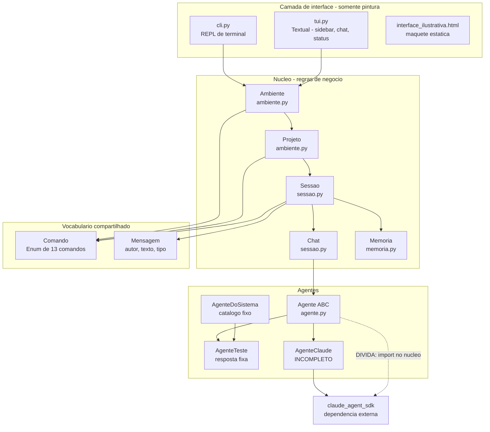
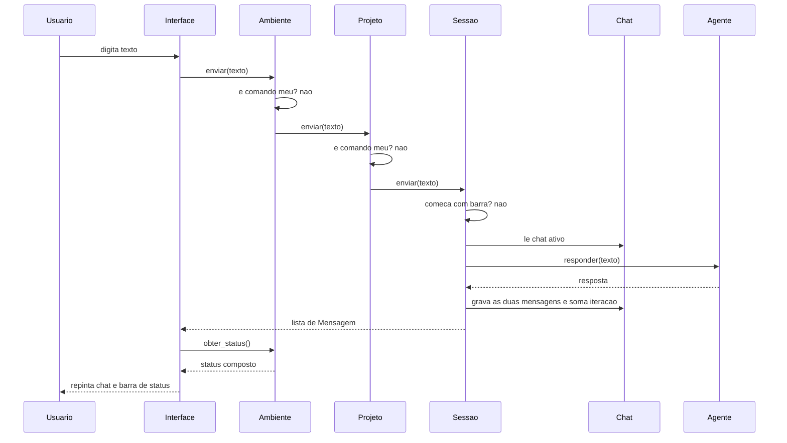
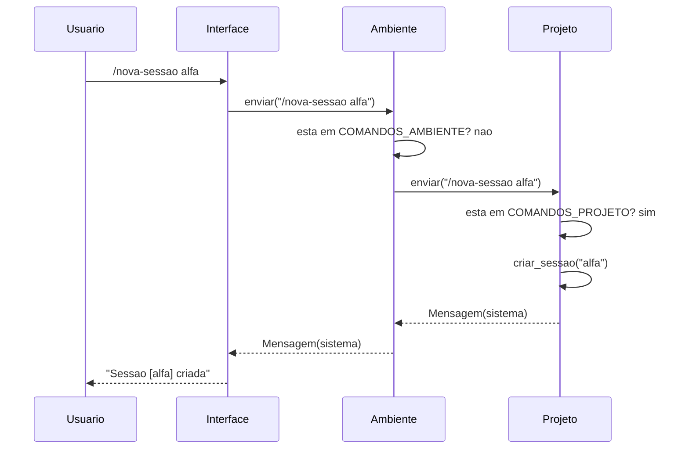

# System Architecture — FishingRod

**Data da análise**: 2026-08-16

---

## System Overview

Aplicação Python monolítica de processo único, **em estágio embrionário** (~900 linhas em 10
arquivos). A arquitetura tem uma forma clara e deliberada, documentada em comentários no próprio
código:

1. **Cadeia por composição** `Ambiente → Projeto → Sessão → Chat`. Cada andar atende só os
   comandos que são dele e delega o resto para baixo. O status sobe pelo caminho inverso —
   *"cada andar acrescenta o próprio nome e delega o resto. Não é repasse: é composição"*
   (`ambiente.py:55-56`).
2. **Núcleo sem estado de interface**. A UI pergunta ao núcleo, compara antes e depois, e
   redesenha (`tui.py:119-149`). Trocar a interface não deve tocar em nenhuma regra.
3. **Memória como blackboard**. Dados puros e serializáveis, `chave → {autor, valor}`, sem
   callables. Os verbos vivem fora.

Não há persistência, servidor, rede, banco de dados ou infraestrutura de nuvem. Tudo vive em
memória e morre com o processo.

---

## Architecture Diagram



**Alternativa em texto**:

```
cli.py / tui.py  (pintura, sem regra)
        |
        v
Ambiente  --comandos /projetos /novo-projeto /trocar-projeto /ajuda /sair
        |
        v
Projeto   --comandos /sessoes /nova-sessao /trocar-sessao
        |
        v
Sessao    --comandos /chats /agentes /nome-chat /novo-chat /trocar-chat
        |            + ultimo andar: responde "nao conheco" ao resto
        +---> Chat  --> Agente (stub hoje) --> claude_agent_sdk (nao ligado)
        +---> Memoria (blackboard chave -> [autor, valor])

model/comando.py + model/mensagem.py = vocabulario fechado, usado por todos
```

---

## Component Descriptions

### `Ambiente` (`Ambiente/ambiente.py:110-205`)
- **Purpose**: topo da cadeia; representa o ambiente de trabalho do usuário.
- **Responsibilities**: gerir a lista de `Projeto`; atender `COMANDOS_AMBIENTE`; delegar o resto
  ao projeto ativo; expor `obter_status()` e a flag `ativo`.
- **Dependencies**: `Projeto`, `Comando`, `Mensagem`.
- **Type**: Application (núcleo).
- **Invariante**: nasce sempre com ao menos um projeto (`projeto-padrao`) — *"o usuário sempre
  está em algum lugar"* (`ambiente.py:120-125`).

### `Projeto` (`Ambiente/ambiente.py:18-104`)
- **Purpose**: andar intermediário; equivale à **frente** no vocabulário do usuário.
- **Responsibilities**: gerir a lista de `Sessao`; atender `COMANDOS_PROJETO`; delegar o resto
  à sessão ativa; compor status.
- **Dependencies**: `Sessao`, `Chat`, `Memoria`, `OrquestradorTeste`, `Comando`, `Mensagem`.
- **Type**: Application (núcleo).
- **Invariante**: nasce sempre com uma sessão (`{nome}-sessao`).
- **Observação**: tem o campo `wiki_local: str = "wiki local....."` — placeholder, sem
  comportamento.

### `Sessao` (`Ambiente/sessao.py:28-144`)
- **Purpose**: unidade de trabalho; equivale ao **card / tarefa** do usuário.
- **Responsibilities**: gerir `chats`; guardar a `Memoria` compartilhada; ser o **último andar**
  da cadeia de comandos; executar o turno de conversa (`enviar`).
- **Dependencies**: `Chat`, `Agente`, `Papel`, `AgenteDoSistema`, `Memoria`, `Comando`, `Mensagem`.
- **Type**: Application (núcleo).
- **Invariante ativa**: no máximo **um** agente com papel `ORQUESTRADOR` (`sessao.py:42-44`,
  reforçado em `criar_chat`, `sessao.py:70-74`).

### `Chat` (`Ambiente/sessao.py:14-25`)
- **Purpose**: a conversa com **um** agente dentro da sessão; a **aba** do usuário.
- **Responsibilities**: guardar o agente, a cópia das mensagens para a UI e o contador de
  iterações.
- **Dependencies**: `Agente`, `Mensagem`.
- **Type**: Application (núcleo).

### `Memoria` / `Anotacao` (`Ambiente/memoria.py`)
- **Purpose**: blackboard da sessão — comunicação **entre** agentes.
- **Responsibilities**: `anotar()`, `anotar_plano()`, `formatar()`; versionar escritas.
- **Dependencies**: nenhuma.
- **Type**: Application (núcleo, dados puros).

### `Agente` (`Ambiente/agente.py`)
- **Purpose**: contrato do que responde no chat.
- **Responsibilities**: dataclass abstrata com `nome`, `papel`, `modelo`, `ferramentas`,
  `regras`, `caixa_de_texto`; método abstrato `responder(mensagem) -> str`.
- **Dependencies**: `claude_agent_sdk.ClaudeAgentOptions` (**dívida** — ver 6.3 do vision.md).
- **Type**: Application (núcleo + adaptador misturados).

### `cli.py`
- **Purpose**: REPL de terminal com menu inicial.
- **Responsibilities**: laço `input → Ambiente.enviar → imprimir`; barra de status.
- **Type**: Application (interface).

### `tui.py`
- **Purpose**: interface Textual com sidebar (projetos + árvore de sessões/chats), log de chat,
  barra de status e campo de entrada.
- **Responsibilities**: pintura pura. Guarda **apenas** estado de pintura (quais cards estão
  abertos, `tui.py:67-71`). Detecta mudança comparando `_posicao()` e `_tamanhos()` antes/depois.
- **Type**: Application (interface).

### `testes-de-aprendizado/spike_claudeSDK.py`
- **Purpose**: spike **descartável** que validou a hipótese arquitetural central — a Sessão pode
  **fabricar ferramentas** já amarradas por closure à memória compartilhada e ao nome do autor,
  de modo que o agente não conhece a Sessão e **não consegue mentir sobre quem é**.
- **Status**: experimento concluído, com 7 descobertas medidas registradas no final do arquivo.
  Não é usado pelo núcleo.
- **Type**: Test/Spike.

---

## Data Flow

### Fluxo 1 — mensagem comum para um agente



### Fluxo 2 — comando de barra atendido no meio da cadeia



**Nota de comportamento**: mensagens produzidas por `Ambiente` e `Projeto` **não** são gravadas
em `chat.mensagens` — só a `Sessao` grava. A TUI compensa isso escrevendo as "efêmeras" por cima
(`tui.py:284-291`).

---

## Integration Points

- **External APIs**: nenhuma ligada. `claude_agent_sdk` é importado, mas `AgenteClaude.responder()`
  devolve `None` — **nada chama LLM hoje**.
- **Databases**: nenhum. Estado 100% em memória.
- **Third-party Services**: MCP externo previsto no produto, **não implementado**.

---

## Infrastructure Components

- **CDK Stacks**: nenhum.
- **Deployment Model**: execução local via `python cli.py` ou `python tui.py`. Sem empacotamento,
  sem `pyproject.toml`, sem containers.
- **Networking**: N/A — processo único, sem porta aberta.
