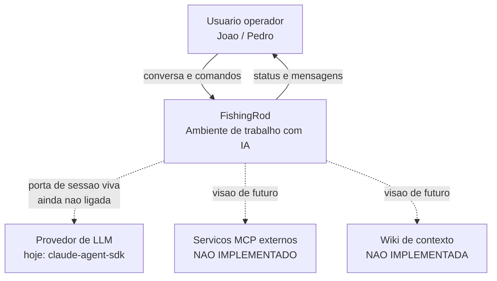

# Business Overview — FishingRod

**Data da análise**: 2026-08-16
**Fonte**: leitura direta do código + `docs/aidlc-inputs/vision.md` + `produto/`

---

## Business Context Diagram

**Alternativa em texto**: o operador conversa com o FishingRod, que hoje responde por conta
própria (agentes stub). As três ligações tracejadas — provedor de LLM, MCP externo e wiki —
estão previstas no produto mas **não existem no código**.

---

## Business Description

- **Business Description**: o FishingRod é um **ambiente de trabalho colaborativo com IA**.
  Uma pessoa ou um time monta a própria estrutura de trabalho — meta, frentes, tarefas, agentes
  e uma wiki de contexto — e opera esse trabalho conversando com agentes de IA. A aposta central
  do produto é que **o contexto acumulado é o ativo**, não a conversa.

- **Business Transactions** (o que o sistema hoje efetivamente implementa):

  | # | Transação | Estado no código |
  |---|---|---|
  | BT-01 | Abrir o ambiente de trabalho | ✅ implementada (`cli.py`, `tui.py`) |
  | BT-02 | Criar / listar / trocar de Projeto | ✅ implementada (`Ambiente`) |
  | BT-03 | Criar / listar / trocar de Sessão | ✅ implementada (`Projeto`) |
  | BT-04 | Criar / listar / trocar / renomear Chat | ✅ implementada (`Sessao`) |
  | BT-05 | Listar agentes disponíveis | ✅ implementada, catálogo fixo em módulo |
  | BT-06 | Conversar com um agente | ⚠️ implementada **com agente stub** — resposta fixa |
  | BT-07 | Consultar o status corrente (onde estou) | ✅ implementada por composição |
  | BT-08 | Anotar no blackboard da Sessão | ⚠️ modelo existe, **nenhum caminho de uso** o aciona |
  | BT-09 | Encerrar o ambiente | ✅ implementada (`/sair`) |
  | BT-10 | Conversar com um agente **real de LLM** | ❌ não implementada (`AgenteClaude.responder` devolve `None`) |
  | BT-11 | Persistir e retomar o trabalho | ❌ não implementada |
  | BT-12 | Escrever / ler a wiki de contexto | ❌ não implementada (só um campo `wiki_local` com texto fixo) |
  | BT-13 | Travar / destravar tarefa por artefato | ❌ não implementada |
  | BT-14 | Colaboração multiusuário | ❌ não implementada |

- **Business Dictionary** — o vocabulário tem **duas línguas**, e a divergência é o achado
  mais importante desta análise:

  | Palavra do usuário | Nome no código | Observação |
  |---|---|---|
  | Ambiente | `Ambiente` | mesma palavra; o usuário carrega **meta** junto, o código não tem meta |
  | Frente | `Projeto` | ⚠️ "projeto" foi descartado pelo usuário por ambiguidade |
  | Card / tarefa | `Sessao` | ⚠️ o card tem `agentes[]` + `memoria[]`; a Sessão tem `chats[]` + `memoria` |
  | Aba | `Chat` | mesmo conceito, palavra diferente |
  | Memória do card | `Memoria` | mesmo formato `chave → {autor, valor}` |
  | Orquestrador | `Papel.ORQUESTRADOR` | invariante: no máximo um por Sessão |
  | Sub-agente | `Papel.SUB_AGENTE` | catálogo fixo em `AgenteDoSistema` |
  | Tipo de tarefa, contrato consome/entrega, travado, etapas | — | ❌ não existem no código |

---

## Component Level Business Descriptions

### `Ambiente/ambiente.py` — Ambiente e Projeto
- **Purpose**: é o topo da cadeia de trabalho. Guarda os Projetos (as "frentes" do usuário) e
  sabe qual está ativo.
- **Responsibilities**: criar/listar/trocar projeto; atender os comandos que são seus; delegar
  o restante ao Projeto ativo; compor o status; sinalizar encerramento (`ativo`).

### `Ambiente/sessao.py` — Sessão e Chat
- **Purpose**: a Sessão é a unidade de trabalho (o "card" do usuário) — reúne os chats de
  agentes e a memória compartilhada entre eles.
- **Responsibilities**: criar/trocar chat; garantir a invariante de **no máximo um orquestrador**;
  ser o último andar da cadeia de comandos (responde "não conheço" em vez de delegar); executar
  o turno de conversa e registrar as mensagens.

### `Ambiente/agente.py` — Agente
- **Purpose**: define o que é um agente (nome, papel, modelo, ferramentas, regras) e como ele
  responde.
- **Responsibilities**: contrato abstrato `responder()`; duas implementações — `AgenteTeste`
  (stub) e `AgenteClaude` (incompleta); catálogo fixo `AgenteDoSistema`.

### `Ambiente/memoria.py` — Memória
- **Purpose**: o **blackboard** da Sessão — o quadro branco onde os agentes deixam recado uns
  para os outros. Por isso cada anotação carrega **autor**.
- **Responsibilities**: guardar `chave → [Anotacao(autor, valor)]`; versionar cada escrita.

### `model/` — Comando e Mensagem
- **Purpose**: vocabulário fechado compartilhado por núcleo e interfaces.
- **Responsibilities**: `Comando` enumera os 13 comandos de barra; `Mensagem` carrega
  `autor`, `texto` e `tipo` (`usuario` | `sistema` | `agente`).

### `cli.py` e `tui.py` — Interfaces
- **Purpose**: pintura. Nenhuma regra de negócio mora aqui.
- **Responsibilities**: coletar entrada, chamar `Ambiente.enviar()`, comparar o status
  antes/depois e redesenhar.

### `interface_ilustrativa.html` — Maquete
- **Purpose**: mostrar a intenção de interface (wiki, kanban, memória da sessão).
- **Responsibilities**: nenhuma — é documento visual, não roda contra o núcleo.
