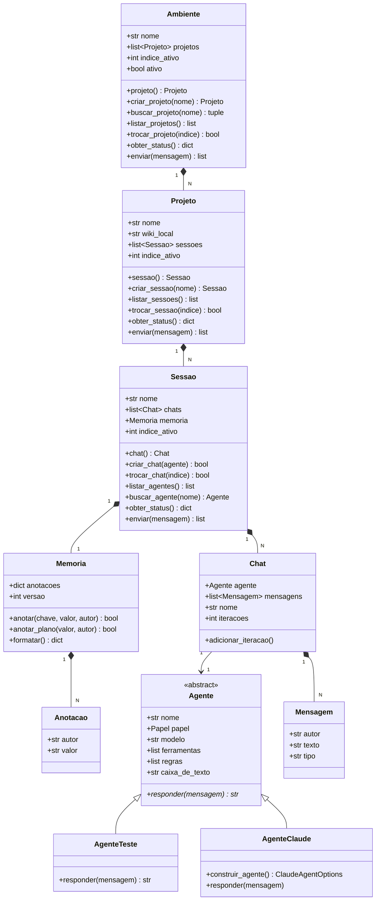

# Code Structure — FishingRod

**Data da análise**: 2026-08-16

---

## Build System

- **Type**: **nenhum**. Não existe `pyproject.toml`, `setup.py`, `requirements.txt`, `Pipfile`
  nem lockfile.
- **Configuration**: apenas `.gitignore` (padrões Python, venv, testes, Windows/OneDrive, IDEs).
- **Consequência**: dependências (`claude-agent-sdk`, `textual`, `rich`) são instaladas à mão e
  **não estão declaradas em lugar nenhum**. Um clone limpo do repositório não roda.
- **Execução hoje**: `python cli.py` ou `python tui.py` a partir da raiz (os imports são
  absolutos a partir da raiz — `from Ambiente.ambiente import ...`).

---

## Key Classes/Modules



**Alternativa em texto**:

```
Ambiente 1--N Projeto 1--N Sessao 1--N Chat 1--1 Agente
                             |                |
                             |                +-- N Mensagem (copia para a UI)
                             +-- 1 Memoria 1--N Anotacao(autor, valor)

Agente (abstrato) <|-- AgenteTeste (stub)
                  <|-- AgenteClaude (incompleto)
```

---

### Existing Files Inventory

Todos são candidatos a modificação no trabalho brownfield.

| Arquivo | Linhas | Propósito |
|---|---:|---|
| `Ambiente/ambiente.py` | 208 | `Projeto` e `Ambiente` — os dois andares de cima da cadeia, com seus comandos |
| `Ambiente/sessao.py` | 149 | `Chat` e `Sessao` — unidade de trabalho, invariante do orquestrador, turno de conversa |
| `Ambiente/agente.py` | 75 | `Papel`, `Agente` (ABC), `AgenteTeste`, `AgenteClaude`, catálogo `AgenteDoSistema` |
| `Ambiente/memoria.py` | 32 | `Anotacao` e `Memoria` — o blackboard da sessão |
| `model/comando.py` | 22 | `Comando` — enum dos 13 comandos de barra |
| `model/mensagem.py` | 8 | `Mensagem` — `autor`, `texto`, `tipo` |
| `cli.py` | 77 | REPL de terminal + menu inicial |
| `tui.py` | 345 | Interface Textual completa (sidebar, árvore, chat, status) |
| `testes-de-aprendizado/spike_claudeSDK.py` | 476 | Spike do `claude-agent-sdk`; **descartável**, com 7 descobertas medidas |
| `testes-de-aprendizado/teste-dict.py` | — | Experimento avulso |
| `interface_ilustrativa.html` | ~55 KB | Maquete de interface (wiki, kanban, memória da sessão) |
| `informacoes-usuario/interface-v3-nexus.html` | — | Material do usuário (insumo, não código) |

**Ausências notáveis**: nenhum `__init__.py` nos pacotes `Ambiente/` e `model/` (funcionam como
namespace packages); nenhum diretório `tests/`; nenhum arquivo de configuração de build.

---

## Design Patterns

### Chain of Responsibility (com composição)
- **Location**: `Ambiente.enviar` → `Projeto.enviar` → `Sessao.enviar`
  (`ambiente.py:201-204`, `ambiente.py:101-104`, `sessao.py:135-144`).
- **Purpose**: cada andar atende só os comandos que lhe pertencem e passa o resto adiante. A
  `Sessao`, sendo o último andar, assume qualquer coisa que comece com `/` — **inclusive dizer
  que não conhece** (`sessao.py:76-81`).
- **Implementation**: par `_detectar_comando_*` + `_acionar_comando` em cada andar, com listas
  de escopo `COMANDOS_AMBIENTE` e `COMANDOS_PROJETO`.

### Composição de status (não repasse)
- **Location**: `obter_status()` nos três andares (`ambiente.py:149-150`, `ambiente.py:54-57`,
  `sessao.py:46-52`).
- **Purpose**: cada andar acrescenta o próprio nome e delega o resto — o dicionário final
  descreve o caminho inteiro.
- **Implementation**: `{"nome_ambiente": self.nome, **self.projeto.obter_status()}`.

### Template Method / ABC
- **Location**: `Agente` (`agente.py:19-35`).
- **Purpose**: fixar o contrato `responder()` e deixar a implementação para o adaptador.
- **Implementation**: `@dataclass` + `ABC` + `@abstractmethod`.

### Núcleo sem estado de interface
- **Location**: `tui.py:67-71` (`_expandidas`), `tui.py:119-149`.
- **Purpose**: trocar a interface não deve tocar em regra. A UI pergunta o status, compara
  antes/depois e redesenha.
- **Implementation**: `_posicao()` e `_tamanhos()` como sondas de mudança; estado de pintura
  guardado por **nome**, não por índice, para sobreviver a criações e trocas.

### Blackboard
- **Location**: `Ambiente/memoria.py`, validado em `spike_claudeSDK.py`.
- **Purpose**: comunicação entre agentes da mesma sessão. Por isso a anotação carrega **autor**
  e é relida a cada chamada.
- **Implementation**: dados puros e serializáveis, sem callables. Os verbos vivem fora,
  fabricados pela Sessão (hipótese validada no spike via closure).

### Invariante de domínio verificada em construção
- **Location**: `Sessao.__post_init__` (`sessao.py:42-44`) e `Sessao.criar_chat`
  (`sessao.py:70-74`).
- **Purpose**: garantir no máximo um orquestrador por sessão.
- **Implementation**: `_contar_orquestradores()`; `__post_init__` levanta `ValueError`,
  `criar_chat` devolve `False`.

### Anti-padrão presente — catálogo global de agentes
- **Location**: `agente.py:54-75` (`OrquestradorTeste`, `RodMakerTeste`, `AgenteDoSistema`).
- **Problema**: instâncias mutáveis de módulo compartilhadas por **todas** as sessões, e todo
  `Projeto` novo aponta o primeiro chat para a **mesma** instância `OrquestradorTeste`
  (`ambiente.py:46`). Não há isolamento entre sessões.

---

## Critical Dependencies

### `claude-agent-sdk`
- **Version**: `0.2.125` (declarada apenas no cabeçalho do spike; não há lockfile).
- **Usage**: importado em `Ambiente/agente.py:6` (`ClaudeAgentOptions`) e usado a fundo em
  `testes-de-aprendizado/spike_claudeSDK.py`.
- **Purpose**: primeiro adaptador de LLM. **Não é decisão de arquitetura** — é escolha
  circunstancial de partida para consumir a assinatura Claude já paga (vision.md §6.4).
- **⚠️ Dívida**: o import em `agente.py:6` acopla um tipo do provedor ao núcleo — proibição
  explícita registrada em vision.md §6.3.

### `textual`
- **Version**: não declarada.
- **Usage**: `tui.py` — `App`, `Screen`, `Widgets`, `Tree`, `ListView`, `RichLog`.
- **Purpose**: interface de terminal.

### `rich`
- **Version**: não declarada (vem junto com `textual`).
- **Usage**: `tui.py:16` — `rich.markup.escape`, para impedir que texto do usuário seja
  interpretado como marcação.
- **Purpose**: formatação e escape.

### `mcp` (indireta)
- **Usage**: apenas via `create_sdk_mcp_server` do `claude-agent-sdk`, no spike.
- **Purpose**: servidor MCP in-process — o mecanismo que amarra ferramenta, memória e autor por
  closure.
