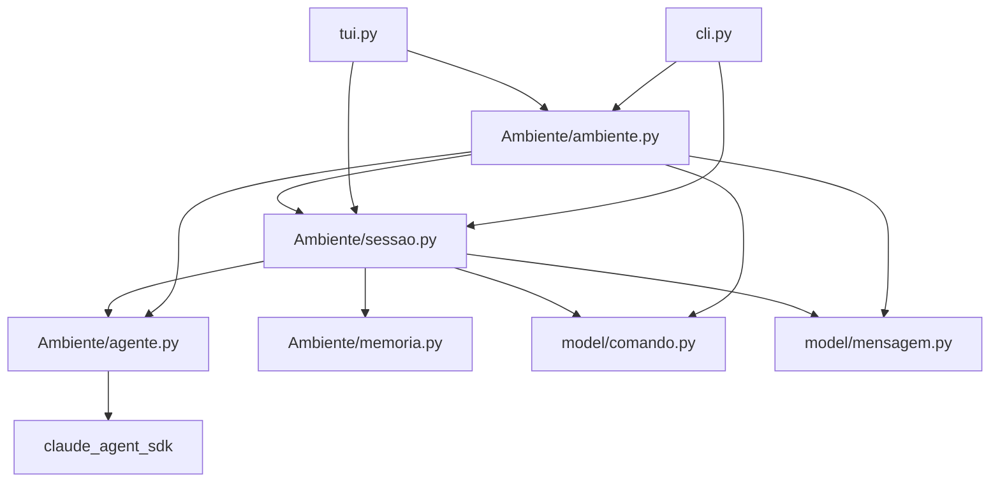

# Dependencies — FishingRod

**Data da análise**: 2026-08-16

---

## Internal Dependencies



**Alternativa em texto**:

```
cli.py  -> Ambiente/ambiente.py, Ambiente/sessao.py
tui.py  -> Ambiente/ambiente.py, Ambiente/sessao.py
Ambiente/ambiente.py -> sessao.py, agente.py, model/comando.py, model/mensagem.py
Ambiente/sessao.py   -> agente.py, memoria.py, model/comando.py, model/mensagem.py
Ambiente/agente.py   -> claude_agent_sdk   <<< DIVIDA: provedor dentro do nucleo
Ambiente/memoria.py  -> (nenhuma)
model/*              -> (nenhuma)
```

O grafo é **acíclico** e respeita a direção da cadeia: cada andar conhece o de baixo, nunca o
de cima.

---

### `cli.py` / `tui.py` dependem de `Ambiente/`
- **Type**: Runtime.
- **Reason**: as interfaces só falam com o topo da cadeia (`Ambiente.enviar`, `obter_status`).
- **⚠️ Reexportação implícita**: ambas importam `Mensagem` de `Ambiente.sessao`, não de
  `model.mensagem` (`cli.py:1-3`, `tui.py:34`). Isso cria um acoplamento acidental — `sessao.py`
  vira caminho de importação de um tipo que não é dele. `ambiente.py:3-7` faz o mesmo com
  `Sessao`, `Chat` e `Memoria`.

### `Ambiente/ambiente.py` depende de `Ambiente/sessao.py`
- **Type**: Runtime.
- **Reason**: `Projeto` cria e delega para `Sessao`.

### `Ambiente/ambiente.py` depende de `Ambiente/agente.py`
- **Type**: Runtime.
- **Reason**: `Projeto.criar_sessao` instancia o chat inicial com `OrquestradorTeste`
  (`ambiente.py:46`).
- **⚠️ Observação**: acopla a criação de sessão a **uma instância global concreta de teste**.

### `Ambiente/sessao.py` depende de `Ambiente/agente.py`
- **Type**: Runtime.
- **Reason**: invariante do orquestrador (`Papel`), catálogo (`AgenteDoSistema`) e chamada de
  `responder()`.

### `Ambiente/agente.py` depende de `claude_agent_sdk`
- **Type**: Runtime (import de módulo).
- **Reason**: `AgenteClaude.construir_agente()` devolve `ClaudeAgentOptions`.
- **🔴 Dívida arquitetural registrada**: viola a proibição explícita em `vision.md` §6.3 —
  *"acoplar tipos do `claude_agent_sdk` ao núcleo"*. O efeito prático é que **nada do núcleo
  importa sem o SDK instalado**: `import Ambiente.sessao` puxa `agente.py`, que puxa o SDK.
  Não há como rodar o núcleo, nem testá-lo, sem a dependência do provedor.

---

## External Dependencies

### `claude-agent-sdk`
- **Version**: `0.2.125` (declarada apenas no docstring de `spike_claudeSDK.py`; **não há
  arquivo de dependências**).
- **Purpose**: primeiro adaptador de LLM. `vision.md` §6.4 é explícito: é **[estado]**, escolha
  circunstancial de partida para consumir a assinatura Claude já paga — **não** decisão de
  arquitetura.
- **License**: MIT (a confirmar contra o pacote instalado).
- **Requisito operacional**: o SDK sobe o CLI `claude` por baixo — exige o CLI **instalado e
  autenticado** na máquina (`spike_claudeSDK.py:17`).

### `textual`
- **Version**: não declarada.
- **Purpose**: interface de terminal.
- **License**: MIT.

### `rich`
- **Version**: não declarada (transitiva de `textual`).
- **Purpose**: `escape` de marcação.
- **License**: MIT.

### `mcp` (transitiva)
- **Purpose**: alcançada via `create_sdk_mcp_server` do `claude-agent-sdk`. Sustenta o mecanismo
  de ferramenta in-process validado no spike.
- **License**: MIT.

---

## Riscos de dependência

| # | Risco | Impacto |
|---|---|---|
| DEP-01 | **Nenhuma dependência declarada** — sem `pyproject.toml`/`requirements.txt` | Clone limpo não roda; versões não reprodutíveis; impossível montar CI |
| DEP-02 | **Núcleo importa o SDK do provedor** (`agente.py:6`) | Quebra o agnosticismo a LLM; impede testar o núcleo isoladamente |
| DEP-03 | `claude-agent-sdk` exige o **CLI `claude` autenticado** na máquina | Dependência de ambiente externo, não capturável por lockfile |
| DEP-04 | Interfaces importam `Mensagem` via `Ambiente.sessao` | Acoplamento acidental; mover o tipo quebra as duas UIs |
| DEP-05 | Versões não fixadas para `textual`/`rich` | `textual` muda API entre versões menores; a TUI pode quebrar sem aviso |
