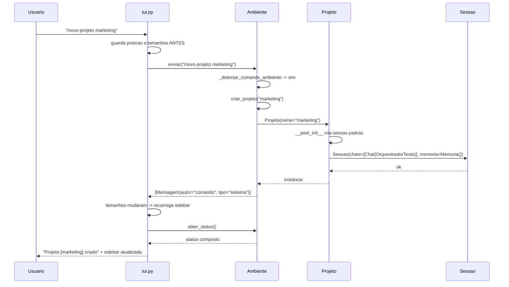
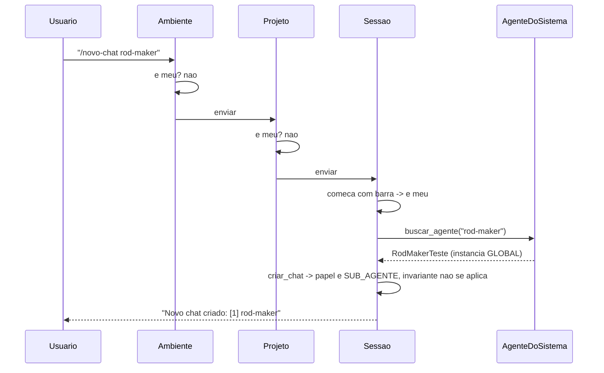
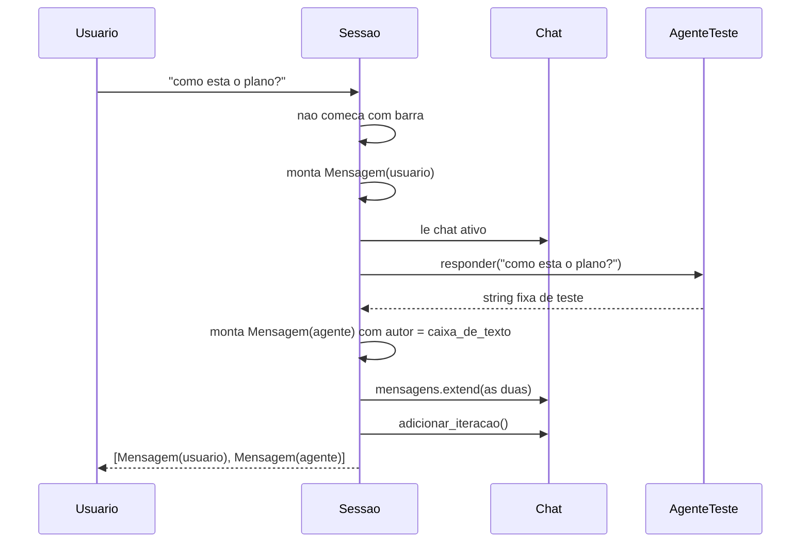
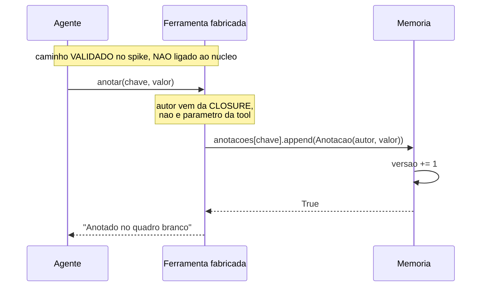
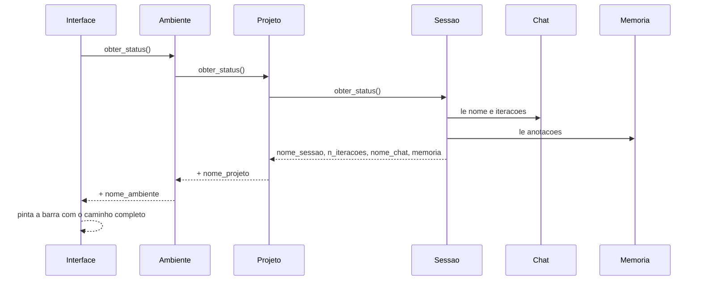
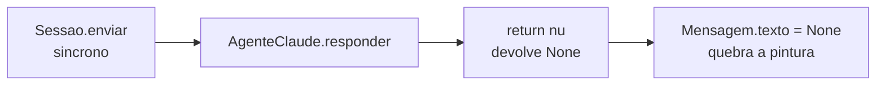

# Interaction Diagrams — FishingRod

**Data da análise**: 2026-08-16
**Propósito**: mostrar como cada transação de negócio é implementada **através** dos componentes.

---

## BT-02 — Criar um Projeto (frente)

**Observação de desenho**: criar projeto **não** troca o projeto ativo. O usuário fica onde
estava — decisão coerente com a cadeia, mas que a interface precisa deixar visível.

---

## BT-04 / BT-05 — Abrir um chat com um sub-agente

**⚠️ Ponto de atenção**: `buscar_agente` consulta o **catálogo global do módulo**, não uma
coleção da sessão. Duas sessões que abram chat com `rod-maker` compartilham a **mesma instância**
de agente.

---

## BT-06 — Conversar com um agente (o caminho que hoje é stub)

**Onde a implementação real entra**: substituir `AgenteTeste` por um adaptador que fale a porta
de sessão viva (`abrir` / `enviar` / `fechar`). Hoje `responder()` é **síncrono e sem estado** —
a assinatura atual não comporta sessão viva.

---

## BT-08 — Anotar no blackboard (modelado, sem caminho de uso)

**Estado real**: nenhum código de produção chama `Memoria.anotar()`. A `Sessao` cria a `Memoria`
e a expõe no status, mas não fabrica ferramenta nenhuma. O spike provou que dá para fazer; o
núcleo ainda não faz.

**⚠️ Defeito**: `Memoria.anotar()` levanta `KeyError` na primeira anotação de qualquer chave —
`self.anotacoes[chave].append(...)` sem `setdefault`.

---

## BT-07 — Consultar status (composição subindo a cadeia)

---

## BT-10 — Conversar com LLM real (**não implementada**)

**Alternativa em texto**: `Sessao.enviar` chama `AgenteClaude.responder()`, que devolve `None`;
`Mensagem` recebe `texto=None`; `tui.formatar` chama `escape(None)` e falha. Ligar o
`AgenteClaude` hoje, sem mais mudanças, quebra a aplicação.

**O que falta para esta transação existir**:
1. `responder()` precisa virar assíncrono (o SDK é `async`) — hoje toda a cadeia `enviar()` é
   síncrona, do `input()` até o `Chat`.
2. Separar **definição de agente** (dados reusáveis) de **client vivo** (conexão com estado).
3. Definir a porta de sessão viva (`abrir` / `enviar` / `fechar`) e confinar os tipos do SDK ao
   adaptador — hoje `agente.py:6` importa `ClaudeAgentOptions` no núcleo.
